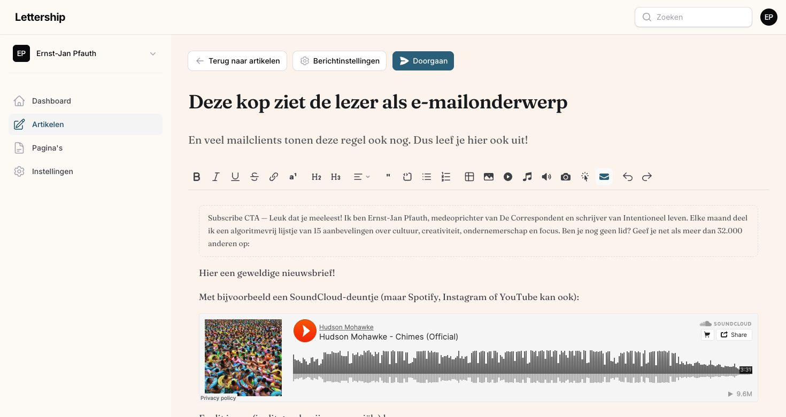
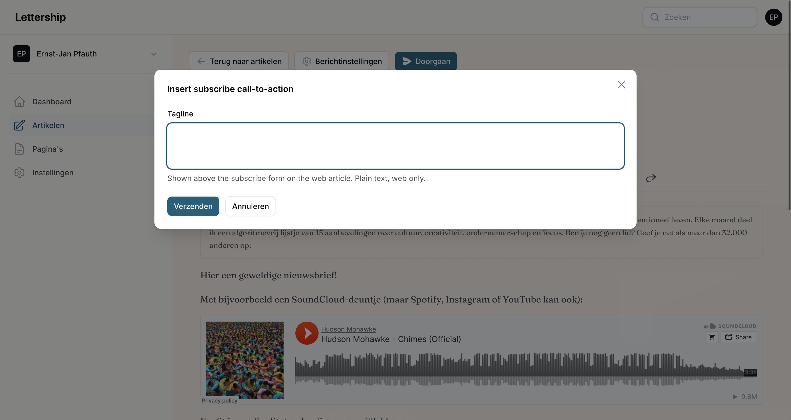
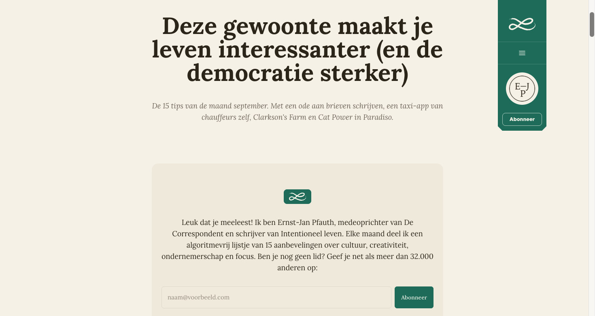
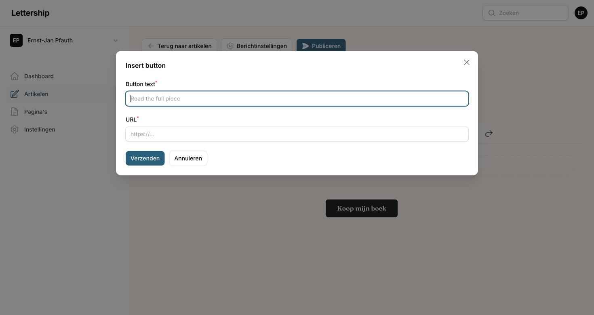
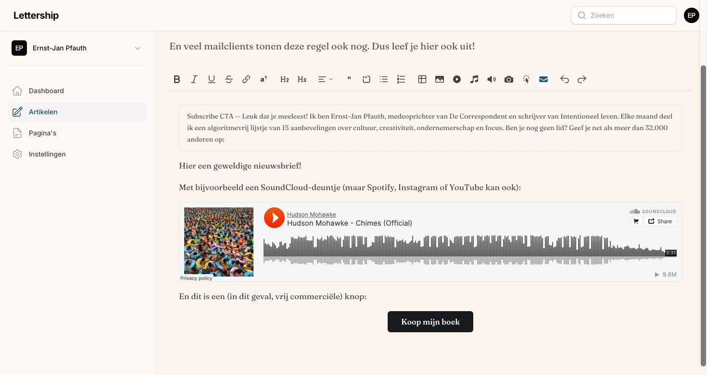
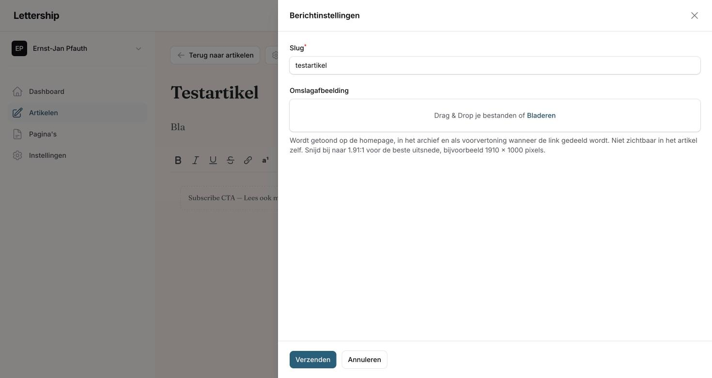
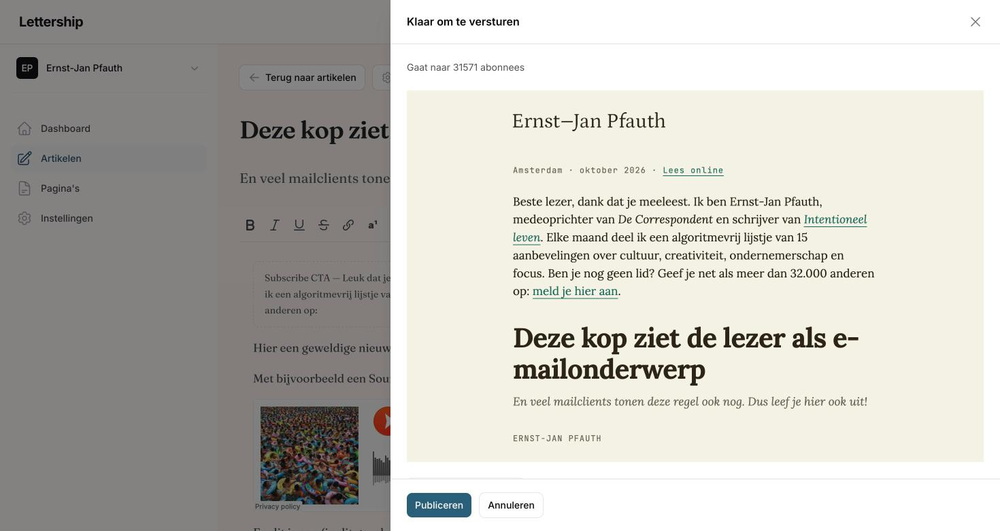
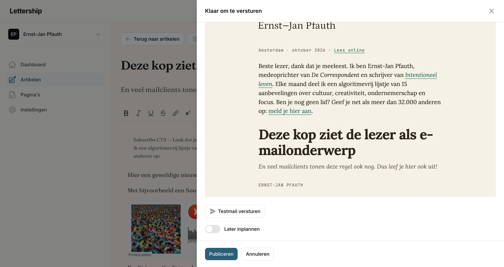
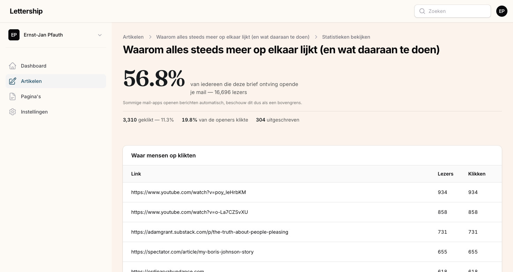

## De editor

Artikelen › Nieuw artikel. Je krijgt een titel, een ondertitel en de tekst.

De titel is het onderwerp van je mail en het belangrijkste regeltje tekst van je hele nieuwsbrief. Denk hier echt over na. Want een onderwerpregel heeft niet als doel de lezer te informeren, maar ervoor te zorgen dat mensen tussen al die mailtjes jouw mailtje uitkiezen om te lezen. Zorg wel dat je de verwachting die de onderwerpregel wekt waarmaakt, want anders is het clickbait.

De ondertitel is in veel mailprogramma's zichtbaar na het onderwerp. Daar licht je nog iets toe, zodat mensen weten wat er in de mail staat en zin hebben om hem te openen. 

In de tekst zelf: maak de tekst scanbaar met koppen en lijsten, want mensen lezen vlot in hun inbox. Spreek lezers direct aan, alsof je ze een goed verhaal vertelt in de kroeg. En als je iets niet weet, vraag het ze. Vrijwel altijd krijg je antwoord. Zegt iemand iets waardevols? Bedank diegene dan bij naam in de volgende editie.

Naast de gewone opmaak (vet, cursief, koppen, citaten, lijsten, tabellen) zitten er een paar knoppen in de werkbalk die je nieuwsbrief laten groeien:

Subscribe action zet een aanmeldformulier in je artikel. Je moet er altijd vanuit gaan dat mensen je nieuwsbrief online lezen terwijl ze nog geen lid zijn, omdat iemand ze de link stuurde. Met dit blok breng je ze op het idee. Zet er een korte, persoonlijke tekst bij (in de mail zelf wordt alleen die tekst getoond, het formulier staat op de webversie). Zo opent mijn septembereditie op de site:

Link button maakt een knop in je accentkleur, met eigen tekst en een link. Ik gebruik deze bijvoorbeeld voor een "Koop mijn boek"-knop bij de aankondiging van een nieuw boek. 

Voetnoot is voor dingen die te ver voeren om in de tekst zelf te noemen, maar die je wel wilt meegeven. Ze verschijnen onderaan het artikel.

Afbeelding toevoegen, met een onderschrift dat in mail en op web wordt getoond. Omdat nieuwsbrieven zo persoonlijk zijn, gebruik ik vaak foto's die ik zelf heb gemaakt.

YouTube, Spotify, SoundCloud en Instagram: plak de link en het fragment staat in je artikel.

Zo ziet dat er in de editor uit, met een Subscribe action bovenin, een SoundCloud-fragment en een knop onderaan:

Link gerust naar dingen die je al eerder hebt gemaakt. Als ik het interessant vind wat jij doet, vind ik het geen spam als je linkt naar een artikel van jezelf. Haal er dan wel één ding uit dat op zichzelf al leuk is, ook als iemand niet doorklikt.

## Berichtinstellingen

Via de knop Berichtinstellingen stel je het webadres van het artikel in en upload je een omslagafbeelding. Die omslag staat niet in de mail of in het artikel zelf, maar is zichtbaar in je archief op Lettership, op sociale media en in zoekmachines. Hij trekt daar de aandacht, dus het is de moeite. Snijd bij naar 1,91:1 (bijvoorbeeld 1910 bij 1000 pixels), dat kan in het dashboard zelf.

## Publiceren

Niemand durft op de knop Publiceren te drukken, en daarom krijgt 'ie binnenkort een nieuwe naam. Dat hoeft ook niet eng te zijn: die knop verstuurt nog niets. Het opent een scherm met je mail precies zoals je lezers hem krijgen, met bovenaan hoeveel abonnees hem gaan ontvangen. Er gaat pas iets uit als je in dat scherm nog een keer op Publiceren klikt.

Onder de voorvertoning staan twee dingen die ik altijd gebruik.

Testmail versturen stuurt de editie naar jezelf, met [Test] voor het onderwerp. Ik doe dit bij elke nieuwsbrief. Ik klik op alle linkjes, kijk of het onderwerp goed overkomt en niet te lang is, en loop de opmaak na. Op desktop én op mijn telefoon.

Later inplannen laat je een dag en tijd kiezen. Kies een vast ritme dat voor jou werkt, dan weten je lezers wat ze kunnen verwachten. Wekelijks is ideaal, dan bouw je het snelst een band op. Red je dat niet, dan kan om de week ook. Eén van mijn nieuwsbrieven is maandelijks, omdat ik het belangrijker vind dat het haalbaar is voor mij dan dat lezers elke week van me horen. Zo'n ritme is ook een stok achter de deur voor jezelf. Incidentele nieuwsbrieven zijn prima, maar dan komt het allemaal op je discipline aan, en je lezers weten niet wat ze kunnen verwachten. Het gaat om de som van je nieuwsbrieven, niet om losstaande edities.

Nog even: een artikel alleen op je site zetten, zonder te mailen, kan nu nog niet. Wil je iets online zonder mail, maak er dan een pagina van. We gaan deze optie nog aanbieden.

Na het versturen gaan je mails geleidelijk uit, zoals bij elke provider. Bij een grote lijst kan dat even duren, en bij je eerste editie na een verhuizing gaat het extra voorzichtig, omdat we onze verzendreputatie beschermen. 
## Leescijfers

Bij elk verzonden artikel staat in het overzicht een knop Leescijfers: hoeveel procent je mail opende, hoeveel mensen klikten, hoeveel zich uitschreven, en een lijst van de links waar mensen op klikten. Beschouw het openpercentage als een bovengrens, sommige mailprogramma's openen berichten automatisch. Mijn ervaring: je publiek heeft vaste gewoontes, die cijfers verschillen van editie tot editie niet zo veel. De kliklijst is het interessantst, daar zie je waar je lezers echt op aanslaan. De rest bekijk ik eigenlijk nooit, uit vrees dat ik naar de mond van mijn publiek ga schrijven.
