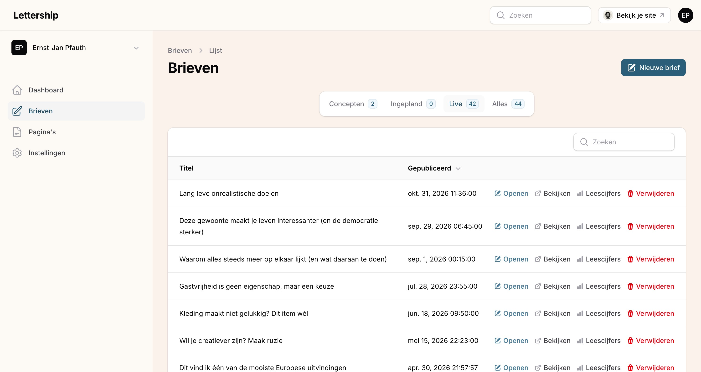
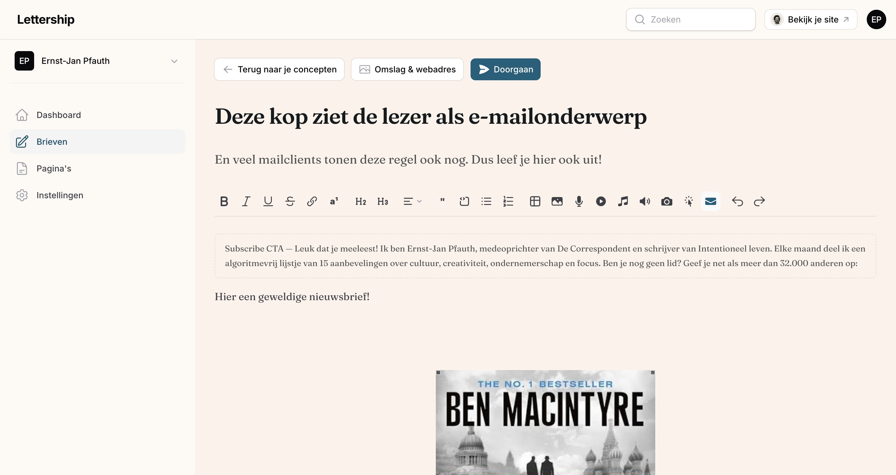
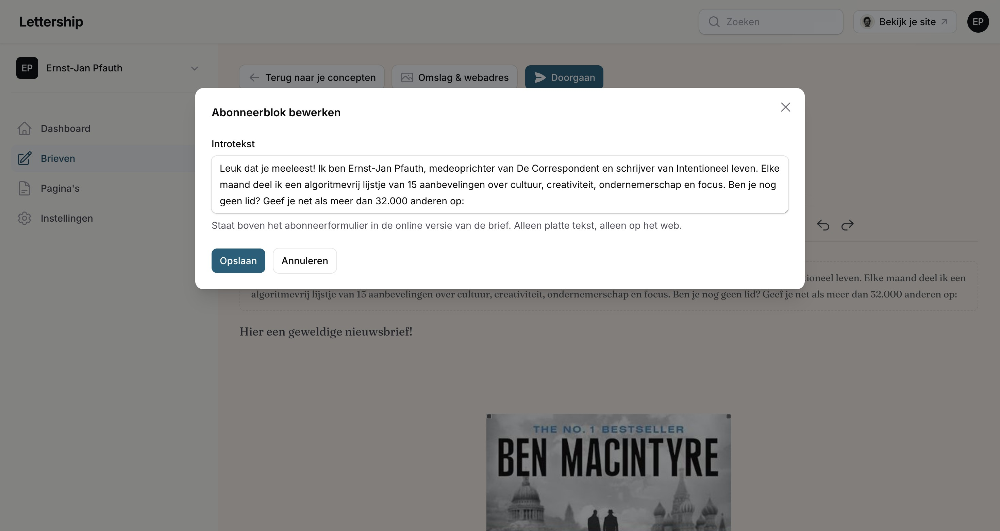
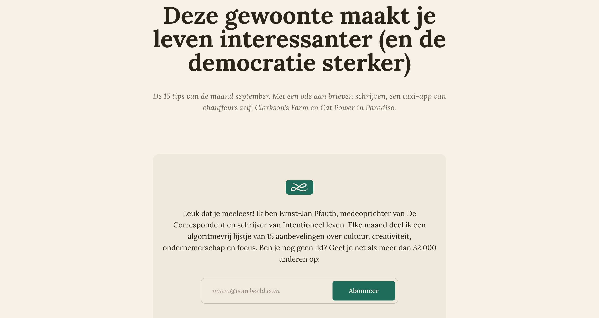
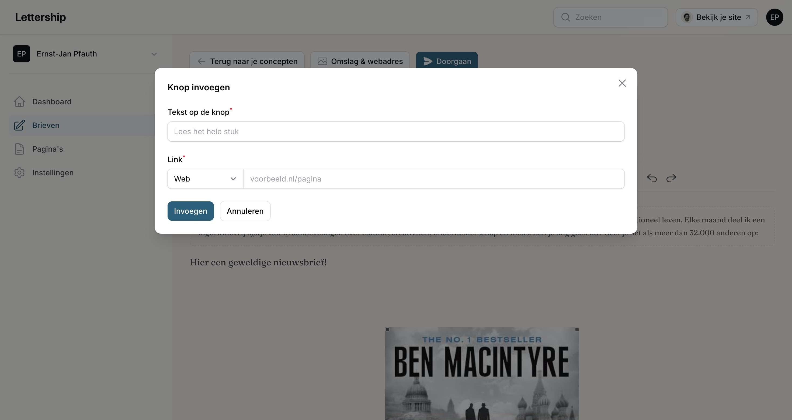
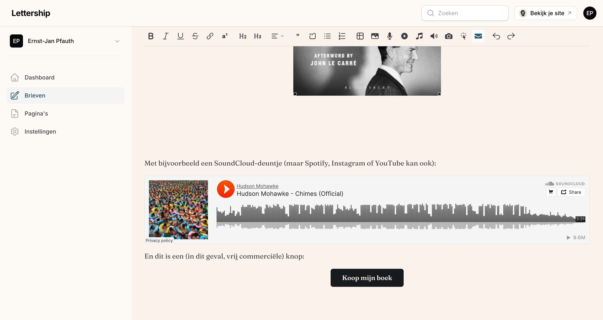
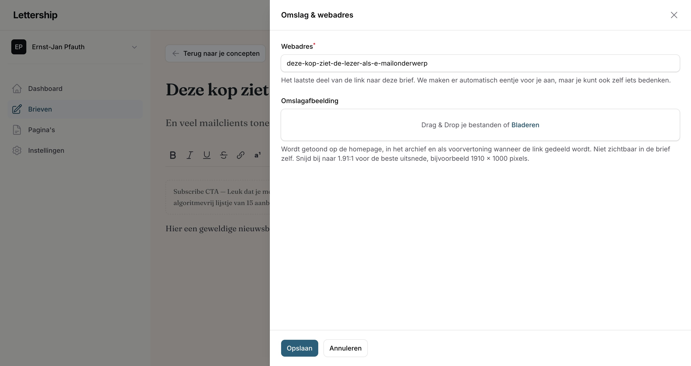
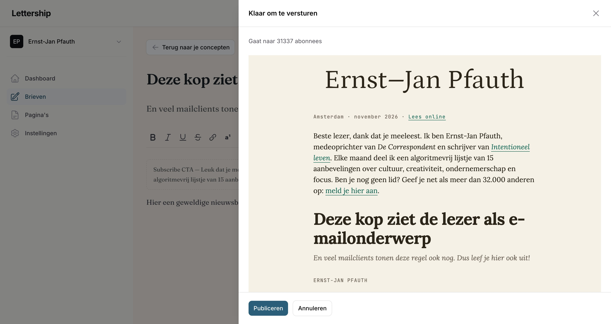
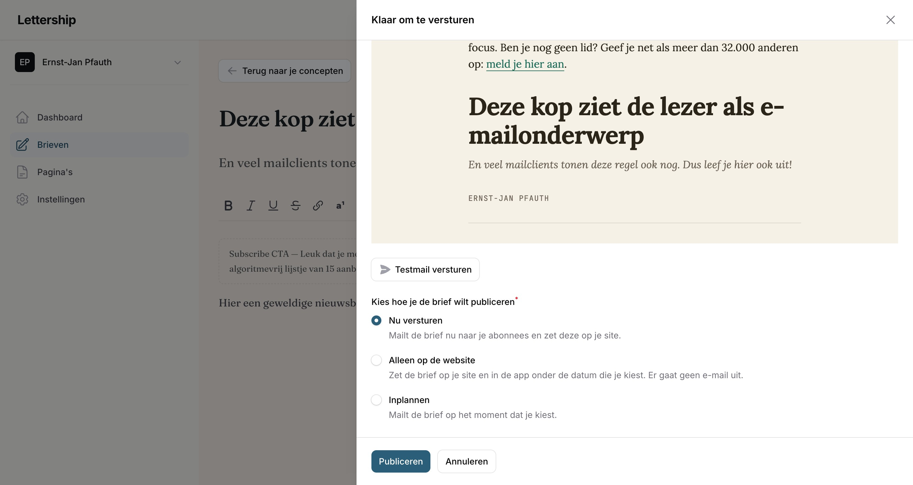

Brieven zijn de edities van je nieuwsbrief. Je schrijft ze in het dashboard en **verstuurt ze als mail** naar je abonnees. Daarnaast komen ze online te staan op je eigen Lettership-pagina, in je archief.

> [!tip] In het kort
> - De **titel** is je onderwerpregel: het belangrijkste regeltje tekst van je hele nieuwsbrief.
> - Het **Abonneerblok** en de **Knop** laten je nieuwsbrief groeien.
> - **Doorgaan verstuurt nog niets.** Je krijgt eerst een voorvertoning, een testmail en de keuze: nu versturen, inplannen of alleen op je site zetten.
> - Kies een **vast ritme**. Het gaat om de som van je nieuwsbrieven.

## Het overzicht

Ga naar **Brieven**. Het overzicht opent op het tabblad **Live**, met je gepubliceerde brieven. Je concepten en ingeplande brieven staan onder **Concepten** en **Ingepland**, en onder **Alles** vind je alles bij elkaar.

Achter elke brief staan de knoppen **Openen** (om hem te bewerken), **Bekijken** (zo staat hij op je site) en **Leescijfers**.

## De editor

Klik op **Nieuwe brief**. Je krijgt een titel, een ondertitel en de tekst. Met **Terug naar je concepten** ga je terug naar het overzicht.

### Titel

De titel is het onderwerp van je mail en **het belangrijkste regeltje tekst van je hele nieuwsbrief**. Denk hier echt over na. Want een onderwerpregel heeft niet als doel de lezer te informeren, maar ervoor te zorgen dat mensen tussen al die mailtjes jouw mailtje uitkiezen om te lezen.

> [!caution] Geen clickbait
> Zorg wel dat je de verwachting die de onderwerpregel wekt waarmaakt, want anders is het clickbait.

### Ondertitel

De ondertitel is in veel mailprogramma's zichtbaar na het onderwerp. Daar licht je nog iets toe, zodat mensen weten wat er in de mail staat en zin hebben om hem te openen.

### De tekst

- **Maak de tekst scanbaar** met koppen en lijsten, want mensen lezen vlot in hun inbox.
- **Spreek lezers direct aan**, alsof je ze een goed verhaal vertelt in de kroeg.
- **Als je iets niet weet, vraag het ze.** Vrijwel altijd krijg je antwoord. Zegt iemand iets waardevols? Bedank diegene dan bij naam in de volgende editie.

## Blokken die je nieuwsbrief laten groeien

Naast de gewone opmaak (vet, cursief, koppen, citaten, lijsten, tabellen) zitten er een paar knoppen in de werkbalk die je nieuwsbrief laten groeien.

### Abonneerblok

Het Abonneerblok zet een aanmeldformulier in je brief. **Je moet er altijd vanuit gaan dat mensen je nieuwsbrief online lezen terwijl ze nog geen lid zijn**, omdat iemand ze de link stuurde. Met dit blok breng je ze op het idee. Zet er bij **Introtekst** een korte, persoonlijke tekst bij.

Wil je die tekst later aanpassen? Klik dan opnieuw op **Abonneerblok** in de werkbalk. Het venster opent met je huidige tekst, en met **Opslaan** pas je het blok aan.

> [!note] In de mail
> In de mail zelf wordt alleen die tekst getoond. Het formulier staat op de webversie.

Zo opent mijn septembereditie op de site:

### Knop

**Knop** maakt een knop in je accentkleur, met eigen tekst en een link. Ik gebruik deze bijvoorbeeld voor een **"Koop mijn boek"-knop** bij de aankondiging van een nieuw boek. Vul de **tekst op de knop** en de **link** in en klik op **Invoegen**.

Een knop kan ook een mail openen: kies bij **Link** dan **E-mail** in plaats van **Web** en vul je mailadres in. Handig voor een knop als "Stuur me een berichtje". Met **Telefoon** belt de lezer je direct.

### En verder

- **Voetnoot** is voor dingen die te ver voeren om in de tekst zelf te noemen, maar die je wel wilt meegeven. Ze verschijnen onderaan de brief.
- **Afbeelding toevoegen**, met een onderschrift dat in mail en op web wordt getoond. Omdat nieuwsbrieven zo persoonlijk zijn, gebruik ik vaak foto's die ik zelf heb gemaakt.
- **Audio:** upload een eigen geluidsfragment (MP3, M4A of WAV, tot 30 MB), met als je wilt een bijschrift. Op je site speelt het fragment direct af. In de mail staat een knop **Beluister het fragment**, die naar het fragment op je site leidt, want mailprogramma's kunnen geen audio afspelen.
- **YouTube, Spotify, SoundCloud en Instagram:** plak de link en het fragment staat in je brief.

Zo ziet dat er in de editor uit, met een SoundCloud-fragment en een knop:

> [!tip] Link gerust naar je eigen werk
> Link gerust naar dingen die je al eerder hebt gemaakt. Als ik het interessant vind wat jij doet, vind ik het geen spam als je linkt naar een stuk van jezelf. Haal er dan wel één ding uit dat op zichzelf al leuk is, ook als iemand niet doorklikt.

## Omslag & webadres

Via de knop **Omslag & webadres** upload je een **omslagafbeelding** en stel je het **webadres** van je brief in.

- **Webadres:** het laatste deel van de link naar je brief. We maken er automatisch een voor je aan, maar je kunt ook zelf iets bedenken.
- **Omslagafbeelding:** die staat niet in de mail of in de brief zelf, maar is zichtbaar op je homepage, in je archief, op sociale media en in zoekmachines. Hij trekt daar de aandacht, dus het is de moeite.

Klik op **Opslaan** om je keuzes te bewaren.

> [!tip] Formaat
> Snijd bij naar 1,91:1 (bijvoorbeeld 1910 bij 1000 pixels). Dat kan in het dashboard zelf.

## Versturen

Niemand durfde op de knop Publiceren te drukken, en daarom heet hij nu **Doorgaan**. Dat hoeft ook niet eng te zijn: **die knop verstuurt nog niets.** Het opent een scherm met je mail precies zoals je lezers hem krijgen, met bovenaan hoeveel abonnees hem gaan ontvangen. Er gaat pas iets uit als je in dat scherm op **Publiceren** klikt.

Onder de voorvertoning staat de knop **Testmail versturen**, en daaronder kies je hoe je de brief publiceert.

### Testmail versturen

Stuurt de editie naar jezelf, met [Test] voor het onderwerp. **Ik doe dit bij elke nieuwsbrief:**

- Ik klik op alle linkjes.
- Ik kijk of het onderwerp goed overkomt en niet te lang is.
- Ik loop de opmaak na. Op desktop én op mijn telefoon.

### Kies hoe je de brief wilt publiceren

- **Nu versturen:** mailt de brief nu naar je abonnees en zet hem op je site. Deze optie staat standaard aan.
- **Alleen op de website:** zet de brief op je site en in de app, zonder dat er een mail uitgaat. Je kiest zelf de datum waaronder hij verschijnt: vandaag of een eerdere dag. Handig als je oudere stukken aan je archief wilt toevoegen.
- **Inplannen:** mailt de brief op het moment dat je kiest. Het veld voor dag en tijd verschijnt zodra je deze optie aanklikt.

Daarna klik je op **Publiceren**.

> [!caution] Controleer het tijdstip
> Kies je **Inplannen**, kijk dan altijd of de dag en tijd kloppen voordat je op Publiceren klikt.

### Een vast ritme

Met **Inplannen** verstuur je op een vaste dag en tijd. **Kies een vast ritme dat voor jou werkt**, dan weten je lezers wat ze kunnen verwachten.

- **Wekelijks** is ideaal, dan bouw je het snelst een band op.
- **Om de week** kan ook, als je wekelijks niet redt.
- **Maandelijks** kan ook. Eén van mijn nieuwsbrieven is maandelijks, omdat ik het belangrijker vind dat het haalbaar is voor mij dan dat lezers elke week van me horen.

Zo'n ritme is ook een stok achter de deur voor jezelf. Incidentele nieuwsbrieven zijn prima, maar dan komt het allemaal op je discipline aan, en je lezers weten niet wat ze kunnen verwachten. **Het gaat om de som van je nieuwsbrieven, niet om losstaande edities.**

> [!note] Je mails gaan geleidelijk uit
> Na het versturen gaan je mails geleidelijk uit, zoals bij elke provider. Bij een grote lijst kan dat even duren, en bij je eerste editie na een verhuizing gaat het extra voorzichtig, omdat we onze verzendreputatie beschermen.

Na het versturen zie je in de [Leescijfers](../leescijfers/) hoe je brief gelezen is.

## Na het versturen: aanpassen of offline halen

Een brief die al verzonden is, kun je nog openen en aanpassen. Die wijzigingen gelden alleen voor de online versie; de mail is al weg.

Wil je een brief van je site halen? Open hem en klik op **Offline halen**. Hij verdwijnt dan van je site, uit je archief en uit de app, maar je leescijfers blijven bewaard. In het overzicht blijft hij onder **Live** staan, met het label **Offline**. Met **Weer online zetten** staat hij weer op hetzelfde webadres.
