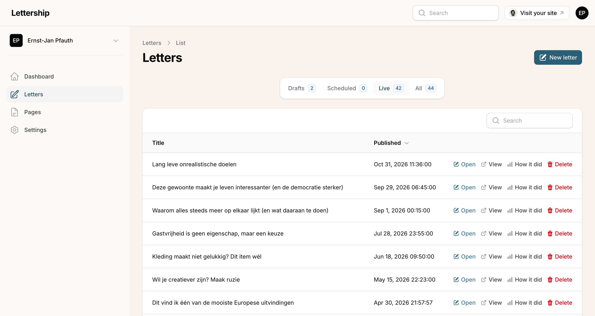
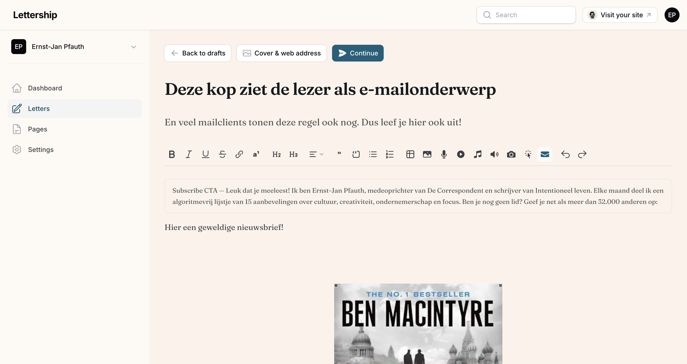
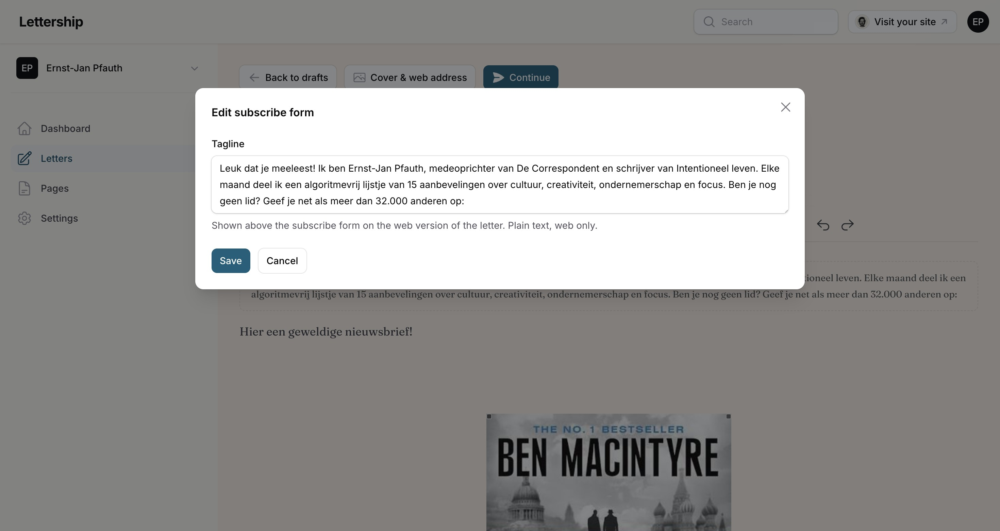
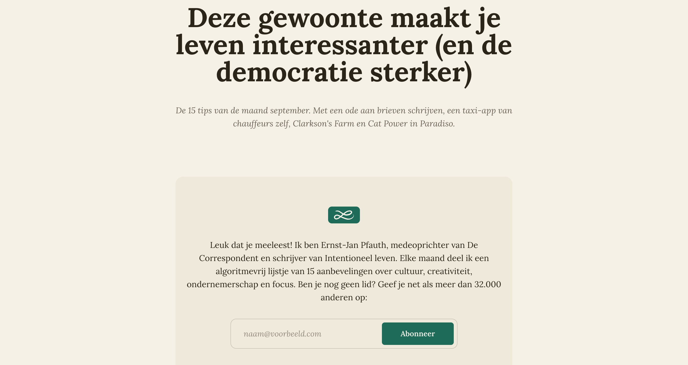
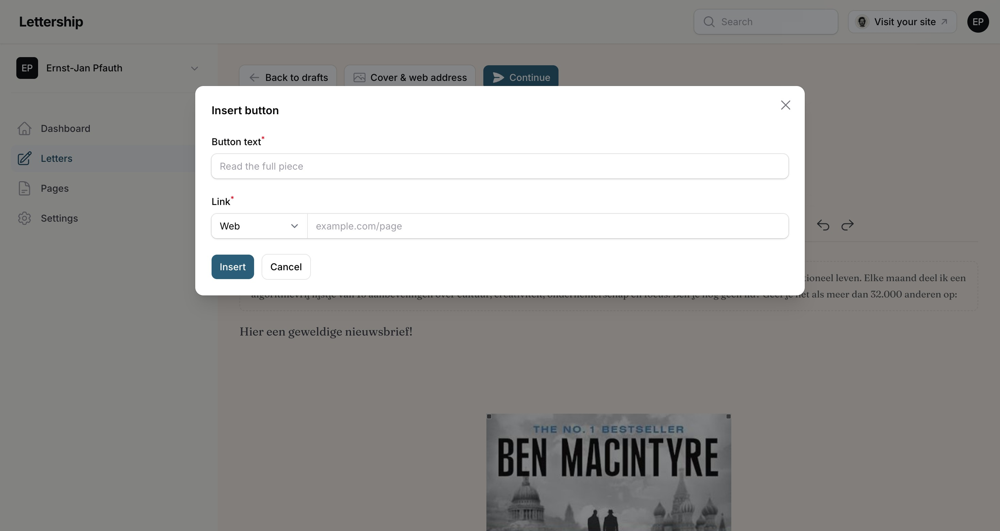
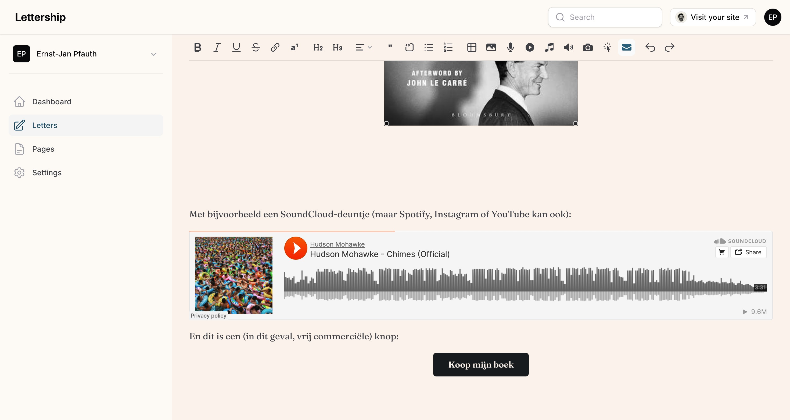
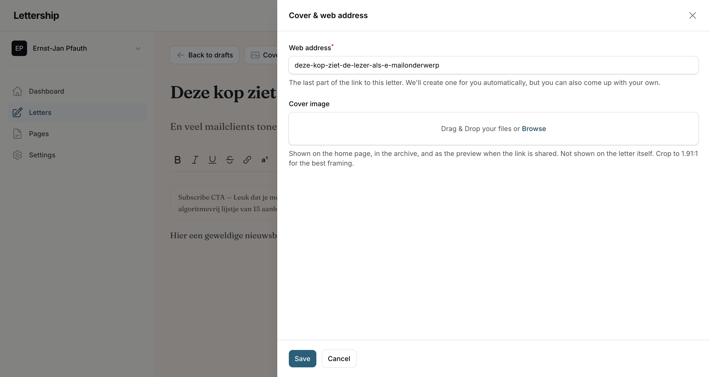
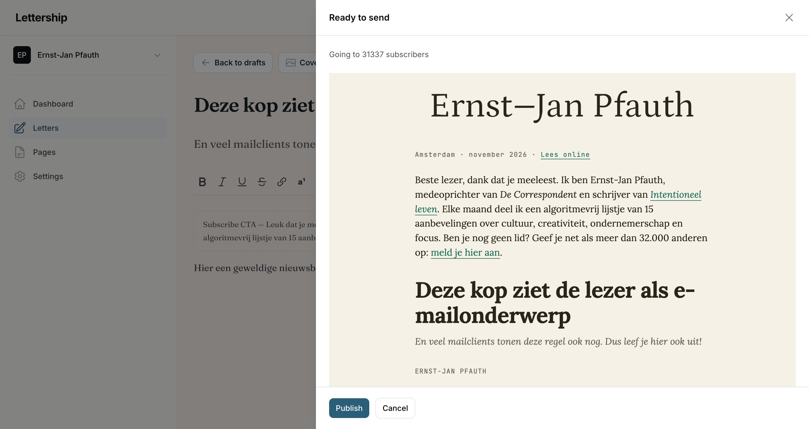
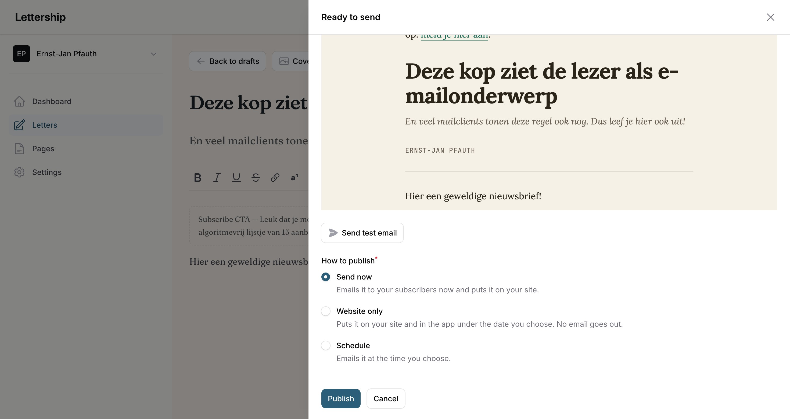

Letters are the editions of your newsletter. You write them in the dashboard and **send them as an email** to your subscribers. They also appear online on your own Lettership page, in your archive.

> [!tip] In short
> - The **title** is your subject line: the most important line of text in your entire newsletter.
> - The **Subscribe form** and the **Button** help your newsletter grow.
> - **Continue doesn't send anything yet.** You first get a preview, a test email and a choice: send now, schedule, or put it on your site only.
> - Choose a **fixed rhythm**. It's the sum of your newsletters that counts.

## The overview

Go to **Letters**. The overview opens on the **Live** tab, with your published letters. Your drafts and scheduled letters are under **Drafts** and **Scheduled**, and **All** shows everything together.

Next to every letter are the buttons **Open** (to edit it), **View** (how it looks on your site) and **How it did**.

## The editor

Click **New letter**. You get a title, a subtitle and the text. **Back to drafts** takes you back to the overview.

### Title

The title is the subject line of your email and **the most important line of text in your entire newsletter**. Really think about this one. Because the purpose of a subject line is not to inform the reader, but to make people pick your email out of all those emails to read.

> [!caution] No clickbait
> Do make sure you live up to the expectation the subject line raises, otherwise it's clickbait.

### Subtitle

The subtitle is visible after the subject in many email clients. Use it to explain a bit more, so people know what's in the email and feel like opening it.

### The text

- **Make it scannable** with headings and lists, because people read quickly in their inbox.
- **Address readers directly**, as if you're telling them a good story in the pub.
- **If you don't know something, ask them.** You'll almost always get an answer. Did someone say something valuable? Thank them by name in the next edition.

## Blocks that help your newsletter grow

Besides the usual formatting (bold, italic, headings, quotes, lists, tables) the toolbar has a few buttons that help your newsletter grow.

### Subscribe form

The Subscribe form puts a sign-up form in your letter. **You should always assume people are reading your newsletter online without being a member yet**, because someone sent them the link. This block gives them the idea. Add a short, personal text under **Tagline**.

Want to change that text later? Click **Subscribe form** in the toolbar again. The dialog opens with your current text, and **Save** updates the block.

> [!note] In the email
> In the email itself only that text is shown. The form appears in the web version.

This is how my September edition opens on the site:

### Button

**Button** makes a button in your accent colour, with your own text and a link. I use it, for example, for a **"Buy my book" button** when announcing a new book. Fill in the **button text** and the **link** and click **Insert**.

A button can also open an email: under **Link**, choose **Email** instead of **Web** and enter your email address. Handy for a button like "Send me a message". With **Phone**, readers call you directly.

### And also

- **Footnote** is for things that go too far to mention in the text itself, but that you still want to pass on. They appear at the bottom of the letter.
- **Image** adds a picture, with a caption that is shown in email and on the web. Because newsletters are so personal, I often use photos I took myself.
- **Audio:** upload your own audio clip (MP3, M4A or WAV, up to 30 MB), with a caption if you like. On your site the clip plays right away. The email shows a **Listen to the clip** button that leads to the clip on your site, because email clients can't play audio.
- **YouTube, Spotify, SoundCloud and Instagram:** paste the link and the embed sits in your letter.

This is what it looks like in the editor, with a SoundCloud embed and a button:

> [!tip] Feel free to link to your own work
> Feel free to link to things you've made before. If I find what you do interesting, I don't consider it spam when you link to a piece of your own. But do pull out one thing that's enjoyable on its own, even if someone doesn't click through.

## Cover & web address

Via the **Cover & web address** button you upload a **cover image** and set the **web address** of your letter.

- **Web address:** the last part of the link to your letter. We create one for you automatically, but you can also come up with your own.
- **Cover image:** it isn't in the email or in the letter itself, but it's visible on your homepage, in your archive, on social media and in search engines. It draws attention there, so it's worth it.

Click **Save** to keep your choices.

> [!tip] Size
> Crop to 1.91:1 (for example 1910 by 1000 pixels). You can do that in the dashboard itself.

## Sending

Done with a first version? Click **Continue**. That button doesn't send anything yet. It opens a screen with your email exactly as your readers will get it, with at the top how many subscribers will receive it. Nothing goes out until you click **Publish** in that screen.

Below the preview is the **Send test email** button, and below that you choose how to publish the letter.

### Send test email

Sends the edition to yourself, with [Test] in front of the subject. **I do this with every newsletter:**

- I click all the links.
- I check whether the subject comes across well and isn't too long.
- I go over the formatting. On desktop and on my phone.

### How to publish

- **Send now:** emails the letter to your subscribers now and puts it on your site. This option is selected by default.
- **Website only:** puts the letter on your site and in the app, without an email going out. You choose the date it appears under: today or an earlier day. Handy if you want to add older pieces to your archive.
- **Schedule:** emails the letter at the time you choose. The field for day and time appears as soon as you select this option.

Then click **Publish**.

> [!caution] Check the time
> If you choose **Schedule**, always check that the day and time are right before you click Publish.

### A fixed rhythm

**Schedule** lets you send on a fixed day and time. **Choose a fixed rhythm that works for you**, so your readers know what to expect.

- **Weekly** is ideal; that's the fastest way to build a bond.
- **Every other week** works too, if you can't manage weekly.
- **Monthly** works as well. One of my newsletters is monthly, because I think it's more important that it's doable for me than that readers hear from me every week.

Such a rhythm also keeps you honest. Occasional newsletters are fine, but then it all comes down to your discipline, and your readers don't know what to expect. **It's the sum of your newsletters that counts, not the individual editions.**

> [!note] Your emails go out gradually
> After sending, your emails go out gradually, as with every provider. With a large list that can take a while, and with your first edition after a move it goes extra carefully, because we protect our sending reputation.

After sending, the [Reading stats](../leescijfers/) show how your letter was read.

## After sending: editing or taking offline

You can still open and edit a letter that has already been sent. Those changes only apply to the online version; the email has already gone out.

Want to take a letter off your site? Open it and click **Take offline**. It then disappears from your site, your archive and the app, but your reading stats are kept. In the overview it stays under **Live**, marked **Offline**. **Put back online** returns it to the same web address.
