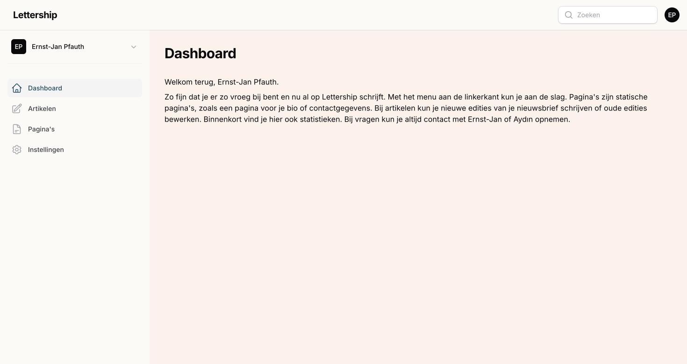

Hi, great that you write on Lettership. In these guides I explain how the platform works and how to make your Lettership your own and grow it.

First things first: you don't have to do everything I describe right away. I'd rather you start typing a good newsletter straight away and don't hit any hurdles. But I do want you to know what's possible. Because a few small changes (a good description of your Lettership, a welcome email, a logo) make readers stay and new readers sign up.

After reading these guides you'll know how to send an article and how to make your Lettership your own. The rest follows. And, I can't say this often enough, don't hesitate to email or message Aydın if something is unclear or doesn't work. I also always enjoy a chat about writing and growing your Lettership.

*Ernst-Jan Pfauth*  
*Co-founder of Lettership*

## Where everything lives

You log in at lettership.com/dashboard. On the left you'll find four sections:

Articles are the editions of your newsletter. You write them here, send them to your subscribers and they also appear online on your own Lettership page.

Pages are standalone, fixed pages such as an 'About me' or 'Contact'. A page is not emailed to your subscribers and doesn't appear among your articles in the archive. You use them for information with a longer shelf life than a single newsletter. I have [a page](https://lettership.pfauth.com/over), for example, where I introduce myself and explain why I write a newsletter.

Settings is where you arrange how your Lettership looks and behaves. That's mostly what these guides are about.

Your own page lives at yourname.lettership.com. That's where your description, your sign-up form, your archive and your pages are. It's what a new reader sees when someone forwards them your link.

If you write for more than one Lettership, you switch at the top left. Each publication has its own settings, articles and pages.

## The chapters

- Setting up your Lettership: [Profile](instellingen/profiel/), [Branding](instellingen/huisstijl/), [Design](instellingen/vormgeving/), [Mail](instellingen/mail/) and [Embed](instellingen/embed/).
- [Articles](artikelen/) — writing an article, publishing it and reading the stats.
- [Pages](paginas/) — standing pages such as 'About me' or a page for your book.

Missing something? Email [Ernst-Jan](mailto:ernst-jan@lettership.com). These guides grow with Lettership: whenever a feature lands, we add it here.

## What's not there yet

Lettership is brand new and we're busy building. A few things your fellow writers ask about that are still to come: an overview of your subscribers in the dashboard, putting an article online without emailing it, reader comments under your articles, and an MCP. As soon as something lands, I'll add it to these guides.

Would you like to see a particular feature on the site? Let me or Aydın know.
