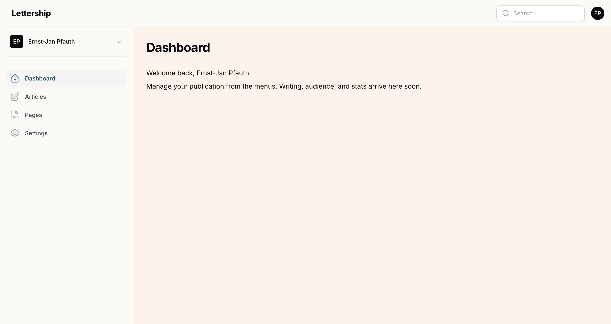

Hi, great that you write on Lettership. In these guides I explain how the platform works and how to make your Lettership your own and grow it.

First things first: you don't have to do everything I describe right away. I'd rather you start typing a good newsletter straight away and don't hit any hurdles. But I do want you to know what's possible. Because a few small changes (a good description of your Lettership, a welcome email, a logo) make readers stay and new readers sign up.

> [!tip] Tip
> Whatever else you do, make sure you write a [welcome email](instellingen/mail/#welcome-email).

After reading these guides you'll know how to send an article and how to make your Lettership your own. The rest follows. And, I can't say this often enough, don't hesitate to email or message Aydın ([aydin@lettership.com](mailto:aydin@lettership.com)) if something is unclear or doesn't work. I also always enjoy a chat about writing and growing your Lettership.

*Ernst-Jan Pfauth*  
*Co-founder of Lettership*  
[ernst-jan@lettership.com](mailto:ernst-jan@lettership.com)

## Where everything lives

You log in at [lettership.com/dashboard](https://lettership.com/dashboard). The menu on the left lists the sections, and each section has its own guide:

**[Articles](artikelen/)** are the editions of your newsletter. You write them here, send them to your subscribers and they also appear online on your own Lettership page.

**[Pages](paginas/)** are standalone, fixed pages such as an 'About me' or 'Contact'. A page is not emailed to your subscribers and doesn't appear among your articles in the archive. You use them for information with a longer shelf life than a single newsletter. I have [a page](https://lettership.pfauth.com/over), for example, where I introduce myself and explain why I write a newsletter.

**Settings** is where you arrange how your Lettership looks and behaves. Each tab has its own guide: [Profile](instellingen/profiel/), [Branding](instellingen/huisstijl/), [Design](instellingen/vormgeving/), [Mail](instellingen/mail/) and [Embed](instellingen/embed/).

> [!note] More than one publication
> If you write for more than one Lettership, you switch at the top left. Each publication has its own settings, articles and pages.

## What are you missing?

Lettership is brand new and we're busy building. A few things your fellow writers ask about that are still to come: an overview of your subscribers in the dashboard, putting an article online without emailing it, reader comments under your articles, and an MCP. As soon as something lands, I'll add it to these guides.

Missing something, or would you like to see a particular feature on the site? Let [me](mailto:ernst-jan@lettership.com) and Aydın ([aydin@lettership.com](mailto:aydin@lettership.com)) know.

PS. A practical note: I don't use AI to write my newsletters, such as the [Lettership Digest](https://digest.lettership.com). But I do use it for some parts of these playbooks. For example, an AI tool automatically updates parts of the guides when we introduce a new feature (and we do that all the time). Just so you know!
