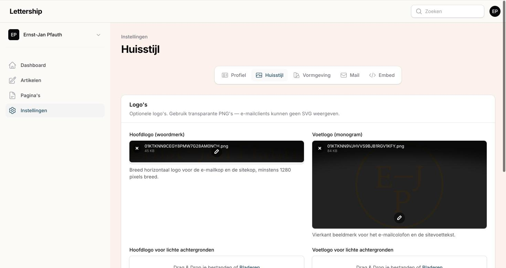
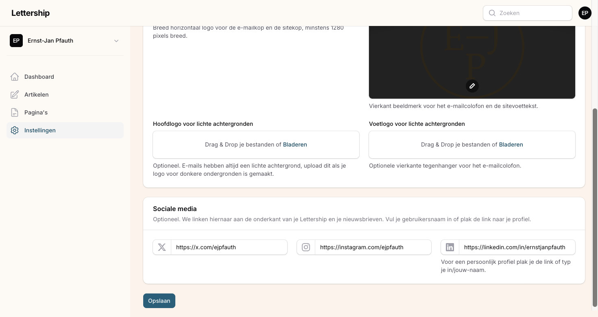
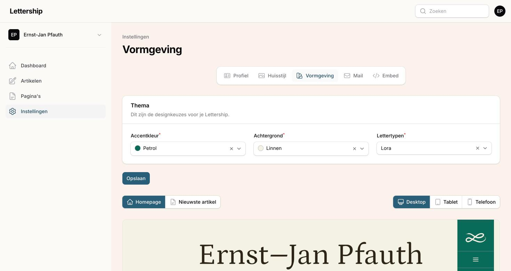
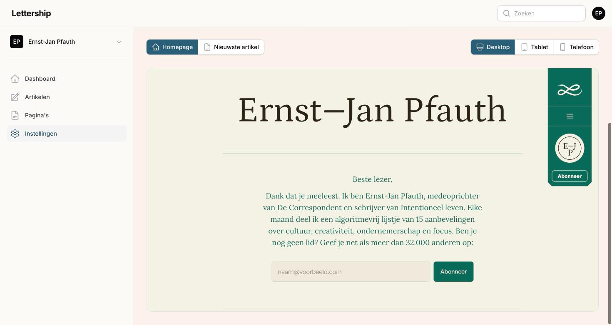
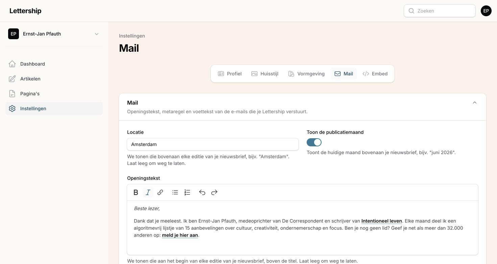
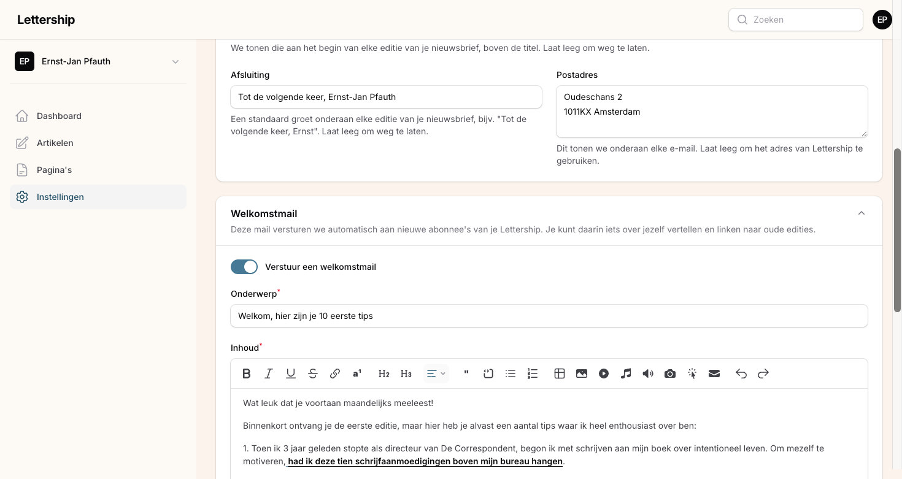
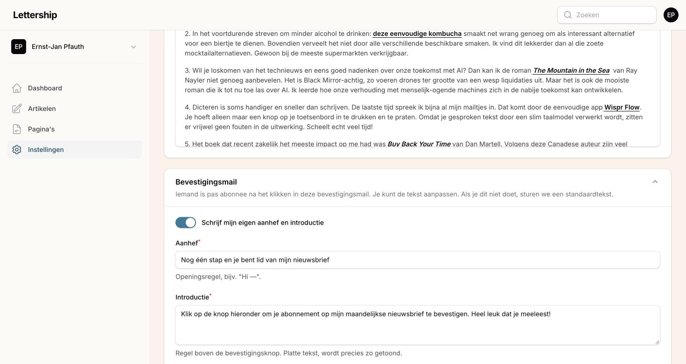
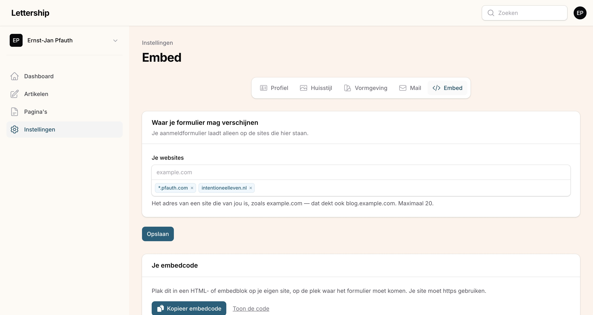
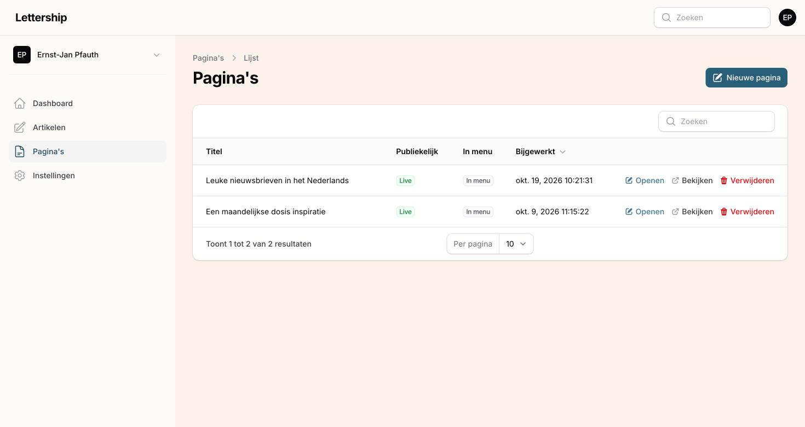
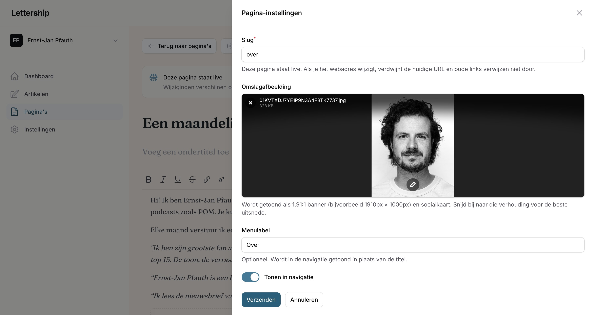

## Your description: the first thing a new reader sees

Go to Settings › Profile. At the bottom you'll find the Description field. This is a very important text, because it's the first thing new visitors see, at the top of your homepage, with the sign-up form right below it. This is where you introduce yourself and convince visitors to subscribe.

What works well:

Say why you're an authority, or what makes you special as a writer. So many people write online that it's important to explain what makes your writing worth it. A bit awkward, I know, but it really helps. Use social proof if you can. I write, for example, that I co-founded De Correspondent and that more than 32,000 people already read the newsletter.

Explain what the reader can expect and what's in it for them. Pick a genre and make it clear: is your newsletter a public mood board, a collection of good links, an open diary, the show notes of your podcast?

And say explicitly that they should subscribe. People look at everything with half their attention, because so much is asking for it. So always spell out every action you want readers to take.

Note: this is a different text from the opening text of your emails (that one lives under Settings › Mail) and different again from a page you create yourself.

The same screen has a few more fields:

Name. Choose an appealing name for your newsletter. Preferably not just your own name (unless you're famous), because then only people who already know you will subscribe. Think of 'In Therapie' by Lena Bril, 'I Like to Watch' by TV critic Anke Meijer, 'Docupdate' by documentary critic Helmut Boeijen. Treat your newsletter as a brand.

Language. Dutch or English. This is the language of your Lettership and your newsletters. If you write in English, set it to English.

Time zone. The clock of your publication. It determines the dates readers see on your emails and the times at which you schedule.

Forward replies to. Readers reply to your newsletter with the reply button in their email client, and only you see those replies. I find all the tips and kind messages an enrichment of my life. For most writers this field can simply stay empty: replies then arrive at the address you use to log in to Lettership. If you'd rather receive them in another inbox, enter that address here.

## Your branding: logos and social links

Settings › Branding. A logo is a nice bonus. It makes your newsletter stand out more and gives your Lettership a face of its own. A nicely designed Lettership immediately signals that the sender takes it seriously. Look at Kapitale Kanttekeningen by Milou Brand, for example, with its own logo and a clear visual line. But don't postpone your first newsletters until your logo is done.

There are four fields. Use transparent PNGs, because email clients can't display SVG.

Main logo (wordmark): a wide, horizontal logo for the top of your emails and your site. At least 1280 pixels wide.

Footer logo (monogram): a square mark for the colophon at the bottom of your emails and the top right of the site.

The two variants for light backgrounds are only needed if you've chosen a dark background for your site. Then you probably have a light logo on it, and that won't work in your emails, because those always have a light background. In that case, upload a version of your logo that works well on light.

Below that: your social links (X, Instagram, LinkedIn). They appear at the very bottom of every email and on your Lettership, so people can follow you elsewhere too. They don't distract from the subscribe button. The most important thing remains that people subscribe, because unlike a follower on X, Instagram or LinkedIn, you own that email address and can take it to any other platform.

## Design

Settings › Design. Three choices: an accent colour (nine options, from Petrol to Bordeaux), a background (six, including one dark one: Aubergine) and a typeface (seven). Below them you immediately see what your homepage and your latest article look like, on desktop, tablet and phone.

I find this hard to give advice on, because it's taste. You pick your favourite typeface and match the colours to what you like. The combinations are chosen so they're always easy to read. The one thing I want to pass on: check the phone view, because that's where most people read you.

## Mail: the standing texts around every edition

Settings › Mail. Okay, this is an important screen. It holds the texts that surround every newsletter, and the two emails every new reader gets first.

### Opening text

It sounds odd, but with every newsletter you have to assume people have forgotten they subscribed to you. Especially if they started following you through a recommendation. The opening text helps with that: it's where you introduce yourself anew every time, above the title of your edition. Who you are again and what you do.

Also put a link to your Lettership in it, so people can subscribe there. Your readers will forward good newsletters, and when their friends open that email, they immediately see where they can subscribe too. My opening text ends with: "Not a member yet? Join more than 32,000 others: sign up here."

### Location and publication month

Above every edition you can show a location (in my case "Amsterdam") and the month of sending. Leave empty if you don't want it.

### Sign-off

A standing greeting at the bottom of every edition. Mine: "Until next time, Ernst-Jan Pfauth". Leave empty to omit it.

### Postal address

By law, every newsletter you send has to contain a postal address. You can put your business address here if you have one. For privacy reasons I wouldn't put your home address in. If you leave it empty, we show Lettership's address.

### Welcome email

Your welcome email is your most important edition. People have just subscribed and are completely open to hearing more from you. So use this email to introduce yourself and the newsletter a bit more extensively, stress what they'll get out of it and share some of your best work already: editions you're proud of, or a book you've written. That way they can read something of yours straight away and you strengthen the fledgling bond that's just begun. It's something you make once, and it helps every new reader after that.

My welcome email is called "Welcome, here are your first 10 tips" and contains ten recommendations from old editions. I also ask people to send me a short email about why they subscribed to my newsletter. I find that instructive.

Flip the switch, choose a subject and write the content in the same editor as your articles. If you've come from another platform, also mention that you now write on Lettership, so readers who find you through an old channel know where to go.

### Confirmation email

The confirmation email is an administrative thing we have to do to prevent spam bots from subscribing to your newsletter, or someone entering somebody else's email address. Someone only becomes a subscriber after clicking the button in this email.

You can use our default text, but you can also choose your own words, because it's the first moment of contact with your reader in their inbox. Keep it short and focused. All that matters is that they confirm their subscription. Mine opens with "One more step and you're a member of my newsletter", followed by: "Click the button below to confirm your subscription to my monthly newsletter. Great to have you reading along!" The opening line says straight away what's expected of the reader.

## A sign-up form on your own site

Settings › Embed. If you have your own site, you want visitors to be able to subscribe to your Lettership there. That's what this form is for. I have it on my personal site, but also on the sites of the books I've written. For me it's a real source of new sign-ups, because people land on those pages via Google.

Here's how it works: first add your site's address under Your websites (example.com also covers blog.example.com). For security reasons the form only works on sites you've listed there. If your web designer works on a test domain, add that too, otherwise they'll only see error messages. Then copy the embed code and paste it into an HTML or embed block on your site. At the bottom of the page you see the real form as a reader sees it (signing up there is real: a confirmation email goes out).

You can also build separate pages with it. For example a page people land on when they scan a QR code in your book or at your talk. My rule: every moment of contact someone has with you should offer the chance to start following you. That's how your list grows.

## Writing and sending

### The editor

Articles › New article. You get a title, a subtitle and the text.

The title is the subject line of your email and the most important line of text in your entire newsletter. Really think about this one. Because the purpose of a subject line is not to inform the reader, but to make people pick your email out of all those emails to read. Do make sure you live up to the expectation the subject line raises, otherwise it's clickbait.

The subtitle is visible after the subject in many email clients. Use it to explain a bit more, so people know what's in the email and feel like opening it.

In the text itself: make it scannable with headings and lists, because people read quickly in their inbox. Address readers directly, as if you're telling them a good story in the pub. And if you don't know something, ask them. You'll almost always get an answer. Did someone say something valuable? Thank them by name in the next edition.

Besides the usual formatting (bold, italic, headings, quotes, lists, tables) the toolbar has a few buttons that help your newsletter grow:

Subscribe action puts a sign-up form in your article. You should always assume people are reading your newsletter online without being a member yet, because someone sent them the link. This block gives them the idea. Add a short, personal text (in the email itself only that text is shown; the form appears in the web version). This is how my September edition opens on the site:

Link button makes a button in your accent colour, with your own text and a link. I use it, for example, for a "Buy my book" button when announcing a new book.

Footnote is for things that go too far to mention in the text itself, but that you still want to pass on. They appear at the bottom of the article.

Image adds a picture, with a caption that is shown in email and on the web. Because newsletters are so personal, I often use photos I took myself.

YouTube, Spotify, SoundCloud and Instagram: paste the link and the embed sits in your article.

This is what it looks like in the editor, with a Subscribe action at the top, a SoundCloud embed and a button at the bottom:

Feel free to link to things you've made before. If I find what you do interesting, I don't consider it spam when you link to an article of your own. But do pull out one thing that's enjoyable on its own, even if someone doesn't click through.

### Post settings

Via the Post settings button you set the web address of the article and upload a cover image. That cover isn't in the email or in the article itself, but it's visible in your archive on Lettership, on social media and in search engines. It draws attention there, so it's worth it. Crop to 1.91:1 (for example 1910 by 1000 pixels); you can do that in the dashboard itself.

### Publishing

Nobody dares to press the Publish button, which is why it's getting a new name soon. It needn't be scary: that button doesn't send anything yet. It opens a screen with your email exactly as your readers will get it, with at the top how many subscribers will receive it. Nothing goes out until you click Publish once more in that screen.

Below the preview are two things I always use.

Send test email sends the edition to yourself, with [Test] in front of the subject. I do this with every newsletter. I click all the links, check whether the subject comes across well and isn't too long, and go over the formatting. On desktop and on my phone.

Schedule for later lets you pick a day and time. Choose a fixed rhythm that works for you, so your readers know what to expect. Weekly is ideal; that's the fastest way to build a bond. If you can't manage that, every other week works too. One of my newsletters is monthly, because I think it's more important that it's doable for me than that readers hear from me every week. Such a rhythm also keeps you honest. Occasional newsletters are fine, but then it all comes down to your discipline, and your readers don't know what to expect. It's the sum of your newsletters that counts, not the individual editions.

One more thing: putting an article on your site only, without emailing it, isn't possible yet. If you want something online without an email, make it a page. We're going to offer this option.

After sending, your emails go out gradually, as with every provider. With a large list that can take a while, and with your first edition after a move it goes extra carefully, because we protect our sending reputation.

### Reading stats

Every sent article has a Reading stats button in the overview: what percentage opened your email, how many people clicked, how many unsubscribed, and a list of the links people clicked. Treat the open rate as an upper limit; some email clients open messages automatically. My experience: your audience has fixed habits, and those numbers don't vary much from edition to edition. The click list is the most interesting; that's where you see what your readers really respond to. The rest I hardly ever look at, for fear of writing to please my audience.

## Pages

I would always make a page explaining who you are and what you stand for. If you have a book or a show, make a separate page for it. And you can use a page to organise your newsletter: if you publish restaurant reviews, link to all the restaurants you've covered on one page.

You write a page in the same editor as an article. Above is my 'About' page, with a short introduction and a few quotes from readers. Via Page settings you choose the web address (mine is simply 'over'), a cover image, and whether the page goes in your site's menu. That menu sits at the bottom of your site. You can give it a shorter title for that menu. Take offline removes a page from your site again; changes to a page that's live appear as soon as you save.

Note: a page is never emailed to your subscribers.

## What's not there yet

Lettership is young. A few things writers ask about that are still to come: an overview of your subscribers in the dashboard, putting an article online without emailing it, reader comments under your articles, and podcast support. As soon as something lands, I'll add it to this guide.

Would you like to see a particular feature on the site? Let me or Aydın know.
