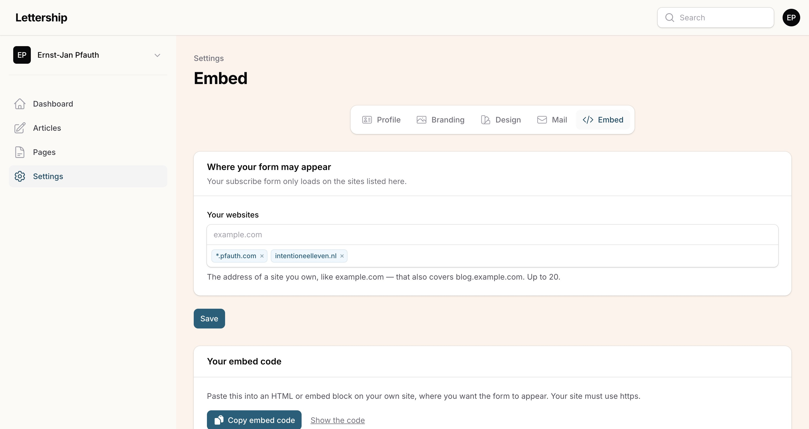

Go to **Settings › Embed**. If you have your own site, you want visitors to be able to subscribe to your Lettership there. That's what this form is for.

I have it on my personal site, but also on the sites of the books I've written. **For me it's a real source of new sign-ups**, because people land on those pages via Google.

## How it works

1. **Add your site's address** under *Your websites* (example.com also covers blog.example.com). For security reasons the form only works on sites you've listed there.
2. **Copy the embed code.**
3. **Paste it into an HTML or embed block** on your site.

> [!caution] Does your web designer work on a test domain?
> Add that too, otherwise they'll only see error messages.

> [!note] The preview is real
> At the bottom of the page you see the real form as a reader sees it. Signing up there is real: a confirmation email goes out.

## Separate pages and QR codes

You can also build separate pages with it. For example a page people land on when they scan a QR code in your book or at your talk.

> [!tip] My rule
> Every moment of contact someone has with you should offer the chance to start following you. That's how your list grows.
