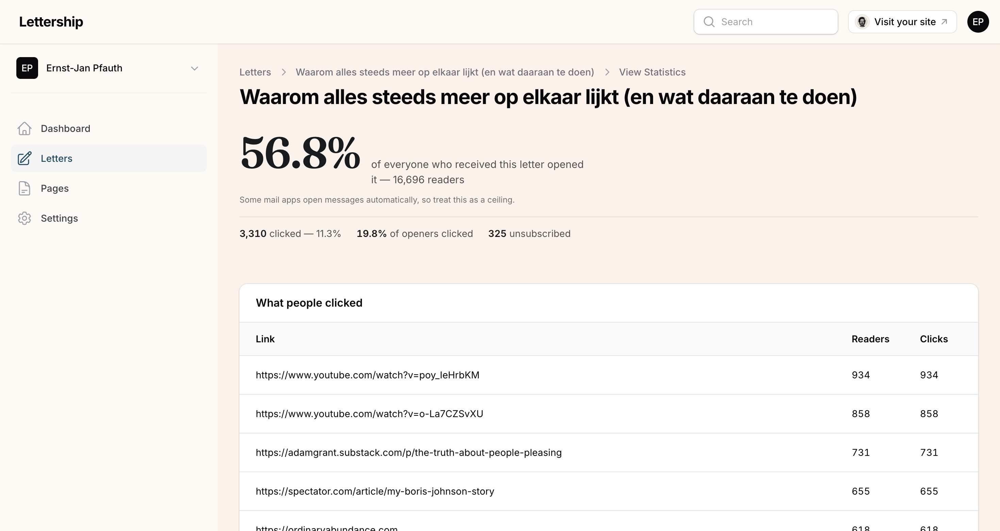

Every sent letter has a **How it did** button in the overview. The same button sits at the top when you open a sent letter. It shows:

- what percentage opened your email;
- how many people clicked;
- how many unsubscribed;
- a list of the links people clicked.

> [!caution] The open rate is an upper limit
> Some email clients open messages automatically.

My experience: your audience has fixed habits, and those numbers don't vary much from edition to edition. **The click list is the most interesting**; that's where you see what your readers really respond to. The rest I hardly ever look at, for fear of writing to please my audience.
