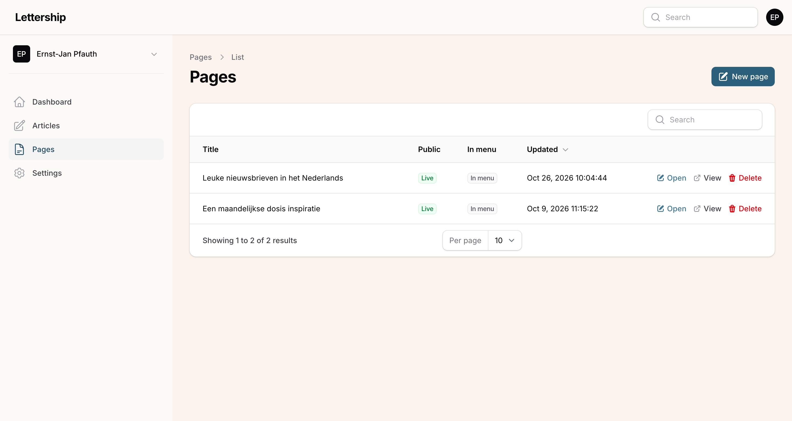
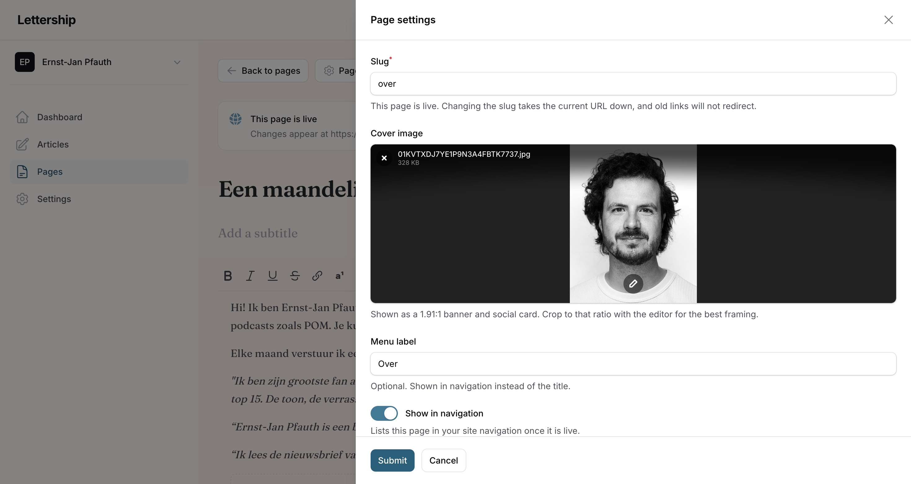

Pages are standalone, fixed pages such as an 'About me' or 'Contact'. A page is not emailed to your subscribers and doesn't appear among your articles in the archive. You use them for information with a longer shelf life than a single newsletter. I have [a page](https://lettership.pfauth.com/over), for example, where I introduce myself and explain why I write a newsletter.

A few ideas:

- **Who you are.** I would always make a page explaining who you are and what you stand for.
- **Your book or show.** If you have one, make a separate page for it.
- **An overview.** You can use a page to organise your newsletter: if you publish restaurant reviews, link to all the restaurants you've covered on one page.

> [!note] Note
> A page is never emailed to your subscribers.

## Making a page

You write a page in the same editor as an [article](../artikelen/). Above is my ['About' page](https://lettership.pfauth.com/over), with a short introduction and a few quotes from readers.

Via **Page settings** you choose:

- the **web address** (mine is simply 'over');
- a **cover image**;
- whether the page goes in your site's **menu**. That menu opens via the menu icon (☰) in the box at the top right of your site. You can give it a shorter title for that menu.

## Taking a page offline

**Take offline** removes a page from your site again. Changes to a page that's live appear as soon as you save.
