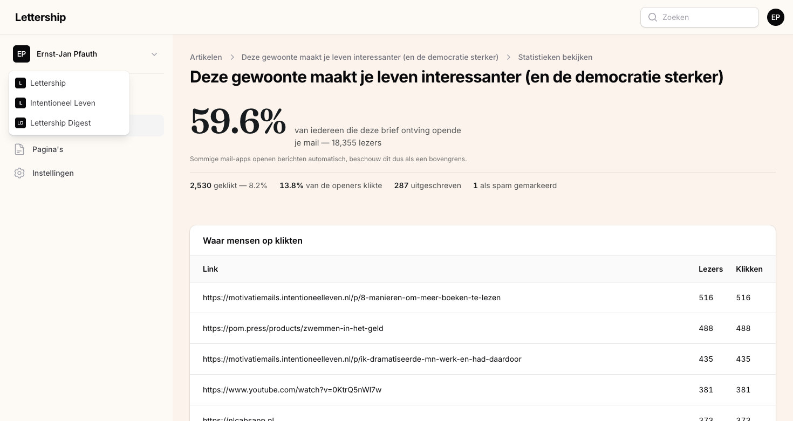

## Waar alles staat

Je logt in via lettership.com/dashboard. Links staan vier onderdelen:

Artikelen zijn de edities van je nieuwsbrief. Die schrijf je hier, verstuur je naar je abonnees en ze komen ook online te staan op je eigen Lettership-pagina.

Pagina's zijn losse, vaste pagina's zoals een 'Over mij' of 'Contact'. Een pagina gaat niet als mail naar je abonnees en verschijnt ook niet tussen je artikelen in het archief. Je gebruikt ze voor informatie met een langere houdbaarheidsdatum dan een losse nieuwsbrief. Ik heb bijvoorbeeld [een pagina](https://lettership.pfauth.com/over) waarop ik mezelf voorstel en uitleg waarom ik een nieuwsbrief schrijf.

Instellingen is waar je de inrichting van je Lettership regelt. Daar gaat deze gids vooral over.

Je eigen pagina vind je op jouwnaam.lettership.com. Daar staan je beschrijving, je aanmeldformulier, je archief en je pagina's. Dat is wat een nieuwe lezer ziet als iemand je link doorstuurt.

Schrijf je voor meer dan één Lettership, dan wissel je linksboven. Elke publicatie heeft eigen instellingen, artikelen en pagina's.

Over abonnees en statistieken: je ziet per verzonden nieuwsbrief hoe hij gelezen is (daarover straks meer bij Leescijfers) en in het verzendscherm hoeveel mensen je mail krijgen. Een overzicht van je abonneebestand zelf komt eraan, dat moeten we nog bouwen.

## Je beschrijving: het eerste wat een nieuwe lezer ziet

Ga naar Instellingen › Profiel. Onderaan staat het veld Beschrijving. Dit is een hele belangrijke tekst, want dit is het eerste wat nieuwe bezoekers zien, bovenaan je homepage, met daaronder het aanmeldformulier. Hiermee stel je jezelf voor en overtuig je bezoekers om zich in te schrijven.

Wat goed werkt:

Geef aan waarom je een autoriteit bent of wat je als schrijver speciaal maakt. Er schrijven zoveel mensen online, dus het is belangrijk om uit te leggen wat jouw teksten bijzonder maken. Beetje ongemakkelijk, weet ik, maar het helpt echt. Gebruik social proof als dat kan. Ik schrijf bijvoorbeeld dat ik medeoprichter van De Correspondent ben en dat meer dan 32.000 mensen de nieuwsbrief al lezen. 

Leg uit wat de lezer kan verwachten en wat hij eraan heeft. Kies een genre en maak dat duidelijk: is je nieuwsbrief een publiek moodboard, een verzameling goede links, een openbaar dagboek, de shownotes van je podcast? 

En maak expliciet dat ze zich moeten inschrijven. Mensen bekijken alles met halve aandacht, omdat er zo veel om aandacht vraagt. Dus je moet altijd alle gewenste acties van lezers uitspellen. 

Let op: dit is een andere tekst dan de openingstekst van je mails (die staat onder Instellingen › Mail) en een andere dan een pagina die je zelf aanmaakt. 

Op dezelfde pagina staan nog een paar velden:

Naam. Kies een aansprekende naam voor je nieuwsbrief. Liever niet alleen je eigen naam (tenzij je beroemd bent), want dan abonneren zich alleen mensen die je al kennen. Denk aan 'In Therapie' van Lena Bril, 'I Like to Watch' van serie-recensent Anke Meijer, 'Docupdate' van documentairerecensent Helmut Boeijen. Zie je nieuwsbrief als een merk.

Taal. Nederlands of Engels. Dit is de taal van je Lettership en je nieuwsbrieven. Schrijf je in het Engels, zet hem dan op Engels.

Tijdzone. De klok van je publicatie. Bepaalt de datums die lezers op je mails zien en de tijden waarop je inplant.

Stuur reacties door naar. Lezers antwoorden op je nieuwsbrief met de reply-knop in hun mailprogramma, en die antwoorden zie alleen jij. Ik vind alle tips en aardige reacties een verrijking van mijn leven. Voor de meeste auteurs kan dit veld gewoon leeg blijven: dan komen de reacties binnen op het adres waarmee je bent ingelogd op Lettership. Ontvang je ze liever in een andere inbox, dan vul je hier dat adres in. 

## Je huisstijl: logo's en social links

Instellingen › Huisstijl. Een logo is een leuke bonus. Het zorgt ervoor dat je nieuwsbrief meer opvalt en je geeft je Lettership er een eigen smoel mee. Een mooi opgemaakte Lettership straalt meteen uit dat de verzender het serieus neemt. Kijk bijvoorbeeld naar Kapitale Kanttekeningen van Milou Brand, met een eigen logo en een duidelijke beeldlijn. Maar stel je eerste nieuwsbrieven niet uit tot je logo gemaakt is.

Er zijn vier velden. Gebruik transparante PNG's, want mailprogramma's kunnen geen SVG tonen.

Hoofdlogo (woordmerk): een breed, horizontaal logo voor de kop van je mails en van je site. Minstens 1280 pixels breed.

Voetlogo (monogram): een vierkant beeldmerk voor het colofon onderaan je mails en rechtsboven op de site. 

De twee varianten voor lichte achtergronden heb je alleen nodig als je een donkere achtergrond hebt gekozen voor je site. Dan staat daar waarschijnlijk een licht logo op, en dat werkt niet in je mails, want die hebben altijd een lichte achtergrond. Upload hier dan een versie van je logo die goed werkt op licht.

Daaronder: je social links (X, Instagram, LinkedIn). Die staan helemaal onderaan elke mail en op je Lettership, zodat mensen je elders ook kunnen volgen. Ze leiden niet af van de aanmeldknop. Het allerbelangrijkste blijft dat mensen zich inschrijven, want in tegenstelling tot een volger op X, Instagram of LinkedIn ben je eigenaar van dat e-mailadres en kun je het meenemen naar elk ander platform. 

## Vormgeving

Instellingen › Vormgeving. Drie keuzes: een accentkleur (negen opties, van Petrol tot Bordeaux), een achtergrond (zes, waaronder één donkere: Aubergine) en een lettertype (zeven). Daaronder zie je meteen hoe je homepage en je nieuwste artikel eruitzien, op desktop, tablet en telefoon.

Ik vind dit lastig om advies over te geven, want het is smaak. Je kiest je favoriete lettertype en stemt de kleuren af op wat jij mooi vindt. De combinaties zijn zo gekozen dat ze altijd goed leesbaar zijn. Het enige wat ik je wil meegeven: bekijk de telefoonweergave, want daar lezen de meeste mensen je.

## Mail: de vaste teksten rond elke editie

Instellingen › Mail. Oké, dit is een belangrijk scherm. Hier staan de teksten die om elke nieuwsbrief heen staan, en de twee mails die elke nieuwe lezer als eerste krijgt.

### Openingstekst

Het klinkt gek, maar je moet er bij elke nieuwsbrief vanuit gaan dat mensen vergeten zijn dat ze zich voor je hebben ingeschreven. Zeker als ze je via een aanbeveling zijn gaan volgen. De openingstekst helpt daarbij: daar stel je jezelf elke keer opnieuw voor, boven de titel van je editie. Wie je ook alweer bent en wat je doet.

Zet er ook een link in naar je Lettership, zodat mensen zich daar kunnen inschrijven. Je lezers gaan goede nieuwsbrieven doorsturen, en als hun vrienden die mail openen, zien ze meteen waar ze zich ook kunnen abonneren. Mijn openingstekst eindigt met: "Ben je nog geen lid? Geef je net als meer dan 32.000 anderen op: meld je hier aan."

### Locatie en publicatiemaand

Boven elke editie kun je een locatie laten tonen (bij mij bijvoorbeeld "Amsterdam") en de maand van verzending. Laat leeg als je het niet wilt.

### Afsluiting

Een vaste groet onderaan elke editie. Bij mij: "Tot de volgende keer, Ernst-Jan Pfauth". Laat leeg om weg te laten.

### Postadres

Het is wettelijk verplicht om een postadres in elke verzonden nieuwsbrief te zetten. Je kunt hier je bedrijfsadres zetten als je dat hebt. Ik zou om privacyoverwegingen je thuisadres er niet neerzetten. Als je niets invult, tonen we het adres van Lettership.

### Welkomstmail

Je welkomstmail is je belangrijkste editie. Mensen hebben zich net ingeschreven en staan helemaal open om meer van je te horen. Dus gebruik deze mail om jezelf en de nieuwsbrief nog wat uitgebreider voor te stellen, benadruk wat zij eraan gaan hebben en deel alvast wat van je beste werk: edities waar je trots op bent, of een boek dat je hebt geschreven. Zo kunnen ze meteen iets van je lezen en versterk je de prille band die net begonnen is. Het is iets wat je één keer maakt en dat daarna elke nieuwe lezer helpt.

Mijn welkomstmail heet "Welkom, hier zijn je 10 eerste tips" en bevat tien aanbevelingen uit oude edities. Ook vraag ik mensen om even kort te mailen waarom ze zich hebben ingeschreven voor mijn nieuwsbrief. Dat vind ik leerzaam.

Zet de schakelaar aan, kies een onderwerp en schrijf de inhoud in dezelfde editor als je artikelen. Kom je van een ander platform, zet er dan ook in dat je voortaan op Lettership schrijft, zodat lezers die je via een oud kanaal vinden, weten waar ze moeten zijn.

### Bevestigingsmail

De bevestigingsmail is een administratief dingetje dat we moeten doen om te voorkomen dat spambots zich op je nieuwsbrief abonneren, of dat iemand andermans e-mailadres invult. Iemand is pas abonnee nadat hij in deze mail op de knop heeft geklikt.

Je kunt onze standaardtekst gebruiken, maar je mag ook je eigen woorden kiezen, want het is het eerste contactmoment met je lezer in zijn inbox. Houd het kort en doelgericht. Het enige wat telt is dat ze hun inschrijving bevestigen. Bij mij is de aanhef "Nog één stap en je bent lid van mijn nieuwsbrief", met daaronder: "Klik op de knop hieronder om je abonnement op mijn maandelijkse nieuwsbrief te bevestigen. Heel leuk dat je meeleest!" De aanhef zegt meteen wat er van de lezer verwacht wordt.

## Een aanmeldformulier op je eigen site

Instellingen › Embed. Als je een eigen site hebt, wil je dat bezoekers zich daar kunnen inschrijven voor je Lettership. Daar is dit formulier voor. Ik heb het op mijn persoonlijke site staan, maar ook op de sites van de boeken die ik heb geschreven. Voor mij is het een echte bron van nieuwe aanmeldingen, want op die pagina's komen mensen via Google terecht.

Zo werkt het: voeg eerst het adres van je site toe bij Je websites (example.com dekt ook blog.example.com). Om veiligheidsredenen werkt het formulier alleen op sites die je daar hebt opgegeven. Werkt je websitebouwer op een testdomein, zet dat er dan ook bij, anders ziet die persoon alleen foutmeldingen. Kopieer daarna de embedcode en plak die in een HTML- of embedblok op je site. Onderaan de pagina zie je het echte formulier zoals een lezer het ziet (aanmelden daar is echt, er gaat een bevestigingsmail uit).

Je kunt er ook aparte pagina's mee bouwen. Bijvoorbeeld een pagina waar mensen terechtkomen als ze een QR-code in je boek of bij je lezing scannen. Mijn regel: elk contactmoment dat iemand met jou heeft, moet de mogelijkheid bieden om je te gaan volgen. Zo groeit je lijst.

## Schrijven en versturen

### De editor

Artikelen › Nieuw artikel. Je krijgt een titel, een ondertitel en de tekst.

De titel is het onderwerp van je mail en het belangrijkste regeltje tekst van je hele nieuwsbrief. Denk hier echt over na. Want een onderwerpregel heeft niet als doel de lezer te informeren, maar ervoor te zorgen dat mensen tussen al die mailtjes jouw mailtje uitkiezen om te lezen. Zorg wel dat je de verwachting die de onderwerpregel wekt waarmaakt, want anders is het clickbait.

De ondertitel is in veel mailprogramma's zichtbaar na het onderwerp. Daar licht je nog iets toe, zodat mensen weten wat er in de mail staat en zin hebben om hem te openen. 

In de tekst zelf: maak de tekst scanbaar met koppen en lijsten, want mensen lezen vlot in hun inbox. Spreek lezers direct aan, alsof je ze een goed verhaal vertelt in de kroeg. En als je iets niet weet, vraag het ze. Vrijwel altijd krijg je antwoord. Zegt iemand iets waardevols? Bedank diegene dan bij naam in de volgende editie.

Naast de gewone opmaak (vet, cursief, koppen, citaten, lijsten, tabellen) zitten er een paar knoppen in de werkbalk die je nieuwsbrief laten groeien:

Subscribe action zet een aanmeldformulier in je artikel. Je moet er altijd vanuit gaan dat mensen je nieuwsbrief online lezen terwijl ze nog geen lid zijn, omdat iemand ze de link stuurde. Met dit blok breng je ze op het idee. Zet er een korte, persoonlijke tekst bij (in de mail zelf wordt alleen die tekst getoond, het formulier staat op de webversie). Zo opent mijn septembereditie op de site:

Link button maakt een knop in je accentkleur, met eigen tekst en een link. Ik gebruik deze bijvoorbeeld voor een "Koop mijn boek"-knop bij de aankondiging van een nieuw boek. 

Voetnoot is voor dingen die te ver voeren om in de tekst zelf te noemen, maar die je wel wilt meegeven. Ze verschijnen onderaan het artikel.

Afbeelding toevoegen, met een onderschrift dat in mail en op web wordt getoond. Omdat nieuwsbrieven zo persoonlijk zijn, gebruik ik vaak foto's die ik zelf heb gemaakt.

YouTube, Spotify, SoundCloud en Instagram: plak de link en het fragment staat in je artikel.

Zo ziet dat er in de editor uit, met een Subscribe action bovenin, een SoundCloud-fragment en een knop onderaan:

Link gerust naar dingen die je al eerder hebt gemaakt. Als ik het interessant vind wat jij doet, vind ik het geen spam als je linkt naar een artikel van jezelf. Haal er dan wel één ding uit dat op zichzelf al leuk is, ook als iemand niet doorklikt.

### Berichtinstellingen

Via de knop Berichtinstellingen stel je het webadres van het artikel in en upload je een omslagafbeelding. Die omslag staat niet in de mail of in het artikel zelf, maar is zichtbaar in je archief op Lettership, op sociale media en in zoekmachines. Hij trekt daar de aandacht, dus het is de moeite. Snijd bij naar 1,91:1 (bijvoorbeeld 1910 bij 1000 pixels), dat kan in het dashboard zelf.

### Publiceren

Niemand durft op de knop Publiceren te drukken, en daarom krijgt 'ie binnenkort een nieuwe naam. Dat hoeft ook niet eng te zijn: die knop verstuurt nog niets. Het opent een scherm met je mail precies zoals je lezers hem krijgen, met bovenaan hoeveel abonnees hem gaan ontvangen. Er gaat pas iets uit als je in dat scherm nog een keer op Publiceren klikt.

Onder de voorvertoning staan twee dingen die ik altijd gebruik.

Testmail versturen stuurt de editie naar jezelf, met [Test] voor het onderwerp. Ik doe dit bij elke nieuwsbrief. Ik klik op alle linkjes, kijk of het onderwerp goed overkomt en niet te lang is, en loop de opmaak na. Op desktop én op mijn telefoon.

Later inplannen laat je een dag en tijd kiezen. Kies een vast ritme dat voor jou werkt, dan weten je lezers wat ze kunnen verwachten. Wekelijks is ideaal, dan bouw je het snelst een band op. Red je dat niet, dan kan om de week ook. Eén van mijn nieuwsbrieven is maandelijks, omdat ik het belangrijker vind dat het haalbaar is voor mij dan dat lezers elke week van me horen. Zo'n ritme is ook een stok achter de deur voor jezelf. Incidentele nieuwsbrieven zijn prima, maar dan komt het allemaal op je discipline aan, en je lezers weten niet wat ze kunnen verwachten. Het gaat om de som van je nieuwsbrieven, niet om losstaande edities.

Nog even: een artikel alleen op je site zetten, zonder te mailen, kan nu nog niet. Wil je iets online zonder mail, maak er dan een pagina van. We gaan deze optie nog aanbieden.

Na het versturen gaan je mails geleidelijk uit, zoals bij elke provider. Bij een grote lijst kan dat even duren, en bij je eerste editie na een verhuizing gaat het extra voorzichtig, omdat we onze verzendreputatie beschermen. 
### Leescijfers

Bij elk verzonden artikel staat in het overzicht een knop Leescijfers: hoeveel procent je mail opende, hoeveel mensen klikten, hoeveel zich uitschreven, en een lijst van de links waar mensen op klikten. Beschouw het openpercentage als een bovengrens, sommige mailprogramma's openen berichten automatisch. Mijn ervaring: je publiek heeft vaste gewoontes, die cijfers verschillen van editie tot editie niet zo veel. De kliklijst is het interessantst, daar zie je waar je lezers echt op aanslaan. De rest bekijk ik eigenlijk nooit, uit vrees dat ik naar de mond van mijn publiek ga schrijven. 

## Pagina's

Ik zou altijd een pagina maken waarop je uitlegt wie je bent en waar je voor gaat. Heb je een boek of een voorstelling, maak daar dan een aparte pagina voor. En je kunt een pagina gebruiken om je nieuwsbrief te organiseren: plaats je restaurantrecensies, dan link je op één pagina alle restaurants die je hebt besproken.

Een pagina schrijf je in dezelfde editor als een artikel. Hierboven mijn 'Over'-pagina, met een korte introductie en een paar citaten van lezers. Via Pagina-instellingen kies je het webadres (bij mij simpelweg 'over'), een omslagafbeelding, en of de pagina in het menu van je site komt. Dat menu staat onderaan je site. Je kunt een kortere titel opgeven voor in dat menu. Met Offline halen haal je een pagina weer van je site; wijzigingen aan een pagina die live staat, verschijnen zodra je opslaat.

Let op: een pagina gaat nooit als mail naar je abonnees.

## Wat er nog niet is

Lettership is jong. Een paar dingen waar auteurs naar vragen en die nog komen: een overzicht van je abonnees in het dashboard, een artikel online zetten zonder te mailen, reacties van lezers onder je artikelen, en podcastondersteuning. Zodra iets erbij komt, vul ik deze gids aan.

Zou jij graag een bepaalde functie op de site zien? Laat het mij of Aydın weten.
