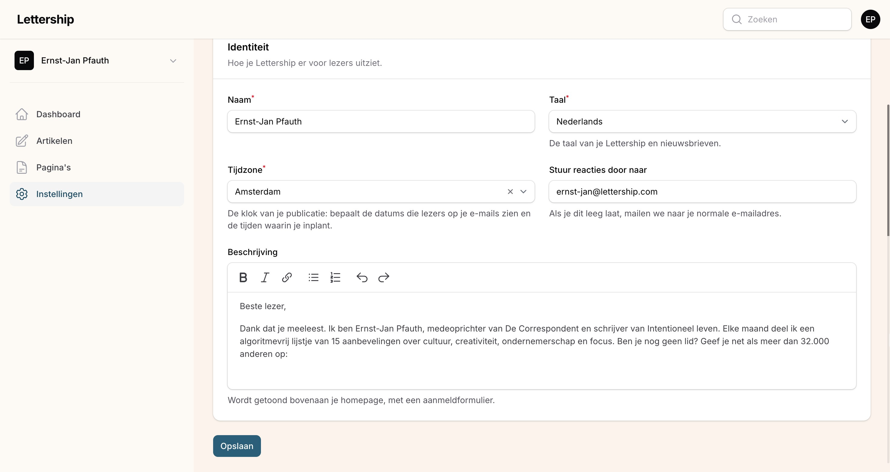

## Je beschrijving: het eerste wat een nieuwe lezer ziet

Ga naar Instellingen › Profiel. Onderaan staat het veld Beschrijving. Dit is een hele belangrijke tekst, want dit is het eerste wat nieuwe bezoekers zien, bovenaan je homepage, met daaronder het aanmeldformulier. Hiermee stel je jezelf voor en overtuig je bezoekers om zich in te schrijven.

Wat goed werkt:

Geef aan waarom je een autoriteit bent of wat je als schrijver speciaal maakt. Er schrijven zoveel mensen online, dus het is belangrijk om uit te leggen wat jouw teksten bijzonder maken. Beetje ongemakkelijk, weet ik, maar het helpt echt. Gebruik social proof als dat kan. Ik schrijf bijvoorbeeld dat ik medeoprichter van De Correspondent ben en dat meer dan 32.000 mensen de nieuwsbrief al lezen. 

Leg uit wat de lezer kan verwachten en wat hij eraan heeft. Kies een genre en maak dat duidelijk: is je nieuwsbrief een publiek moodboard, een verzameling goede links, een openbaar dagboek, de shownotes van je podcast? 

En maak expliciet dat ze zich moeten inschrijven. Mensen bekijken alles met halve aandacht, omdat er zo veel om aandacht vraagt. Dus je moet altijd alle gewenste acties van lezers uitspellen. 

Let op: dit is een andere tekst dan de openingstekst van je mails (die staat onder Instellingen › Mail) en een andere dan een pagina die je zelf aanmaakt. 

Op dezelfde pagina staan nog een paar velden:

Naam. Kies een aansprekende naam voor je nieuwsbrief. Liever niet alleen je eigen naam (tenzij je beroemd bent), want dan abonneren zich alleen mensen die je al kennen. Denk aan 'In Therapie' van Lena Bril, 'I Like to Watch' van serie-recensent Anke Meijer, 'Docupdate' van documentairerecensent Helmut Boeijen. Zie je nieuwsbrief als een merk.

Taal. Nederlands of Engels. Dit is de taal van je Lettership en je nieuwsbrieven. Schrijf je in het Engels, zet hem dan op Engels.

Tijdzone. De klok van je publicatie. Bepaalt de datums die lezers op je mails zien en de tijden waarop je inplant.

Stuur reacties door naar. Lezers antwoorden op je nieuwsbrief met de reply-knop in hun mailprogramma, en die antwoorden zie alleen jij. Ik vind alle tips en aardige reacties een verrijking van mijn leven. Voor de meeste auteurs kan dit veld gewoon leeg blijven: dan komen de reacties binnen op het adres waarmee je bent ingelogd op Lettership. Ontvang je ze liever in een andere inbox, dan vul je hier dat adres in.
