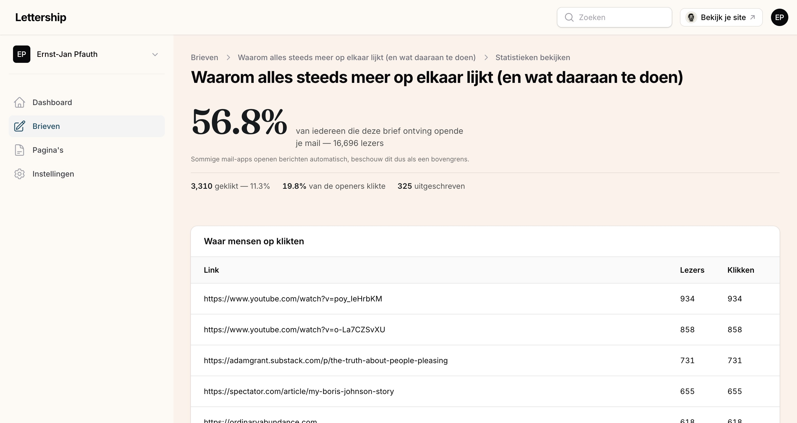

Bij elke verzonden brief staat in het overzicht een knop **Leescijfers**. Dezelfde knop staat bovenaan als je een verzonden brief opent. Daar zie je:

- hoeveel procent je mail opende;
- hoeveel mensen klikten;
- hoeveel zich uitschreven;
- een lijst van de links waar mensen op klikten.

> [!caution] Het openpercentage is een bovengrens
> Sommige mailprogramma's openen berichten automatisch.

Mijn ervaring: je publiek heeft vaste gewoontes, die cijfers verschillen van editie tot editie niet zo veel. **De kliklijst is het interessantst**, daar zie je waar je lezers echt op aanslaan. De rest bekijk ik eigenlijk nooit, uit vrees dat ik naar de mond van mijn publiek ga schrijven.
